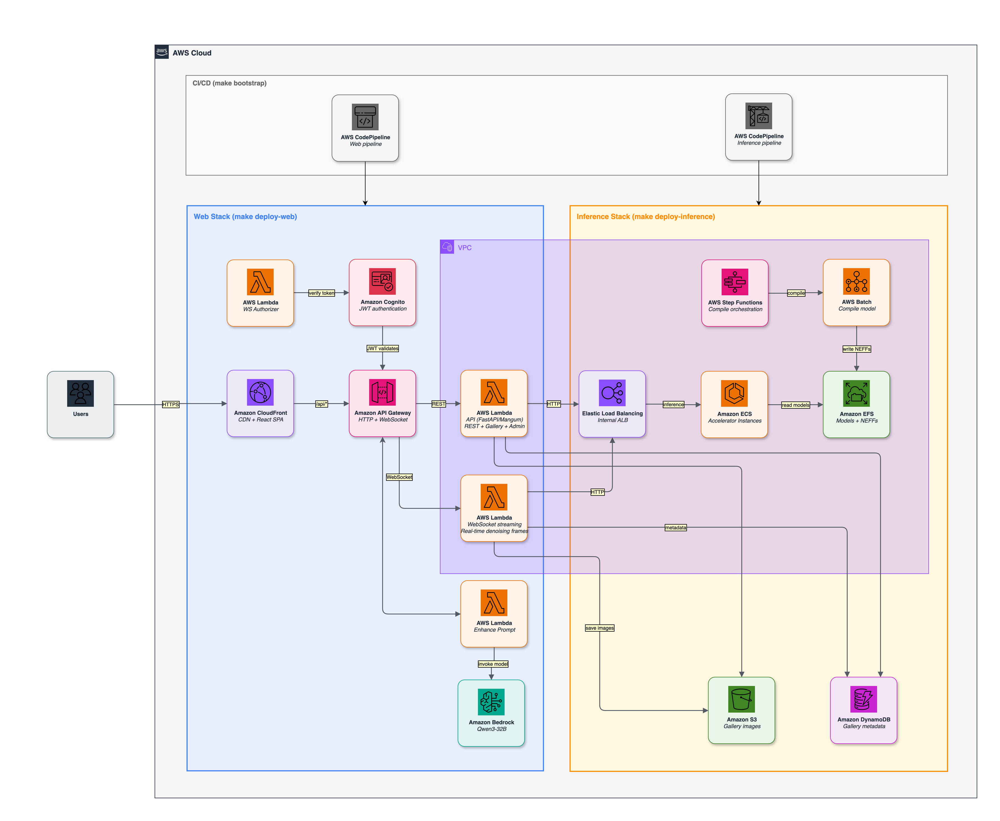
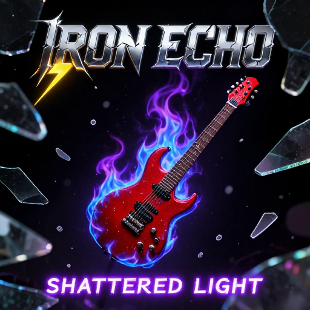
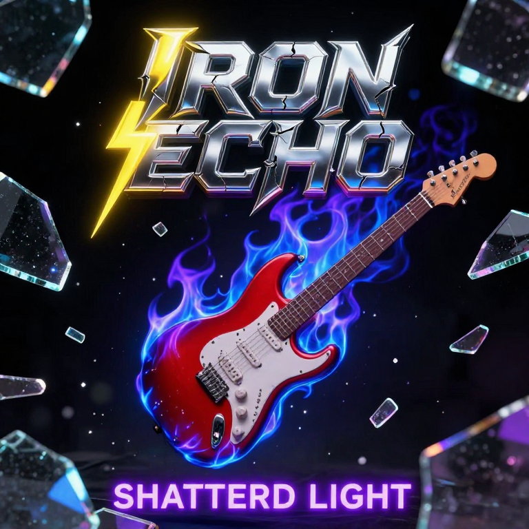
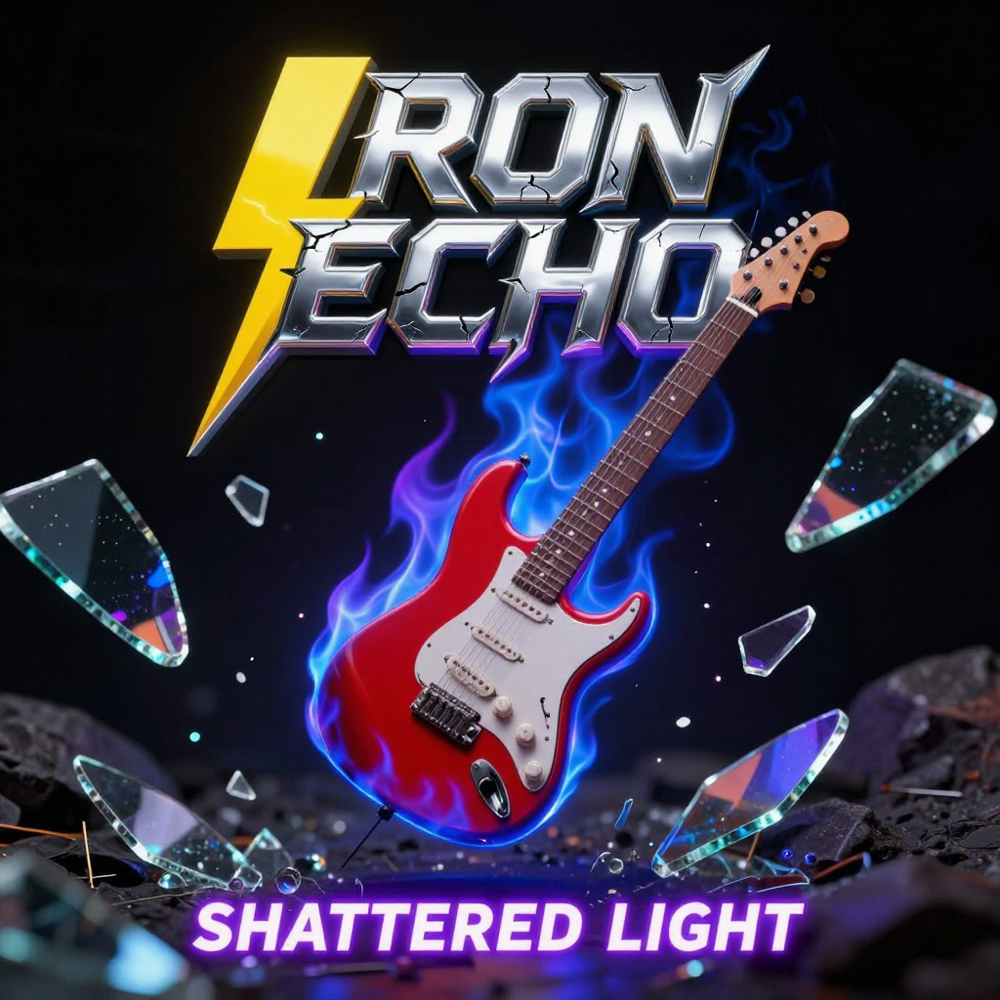
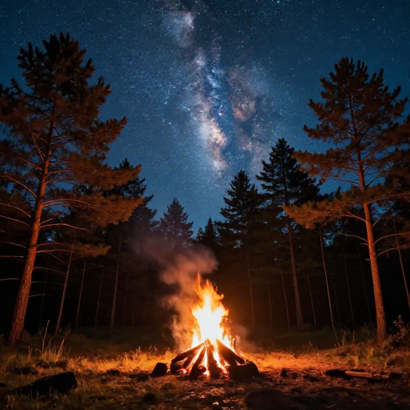
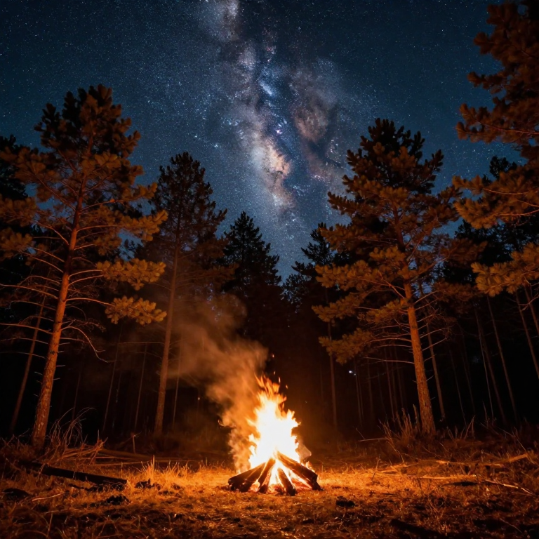
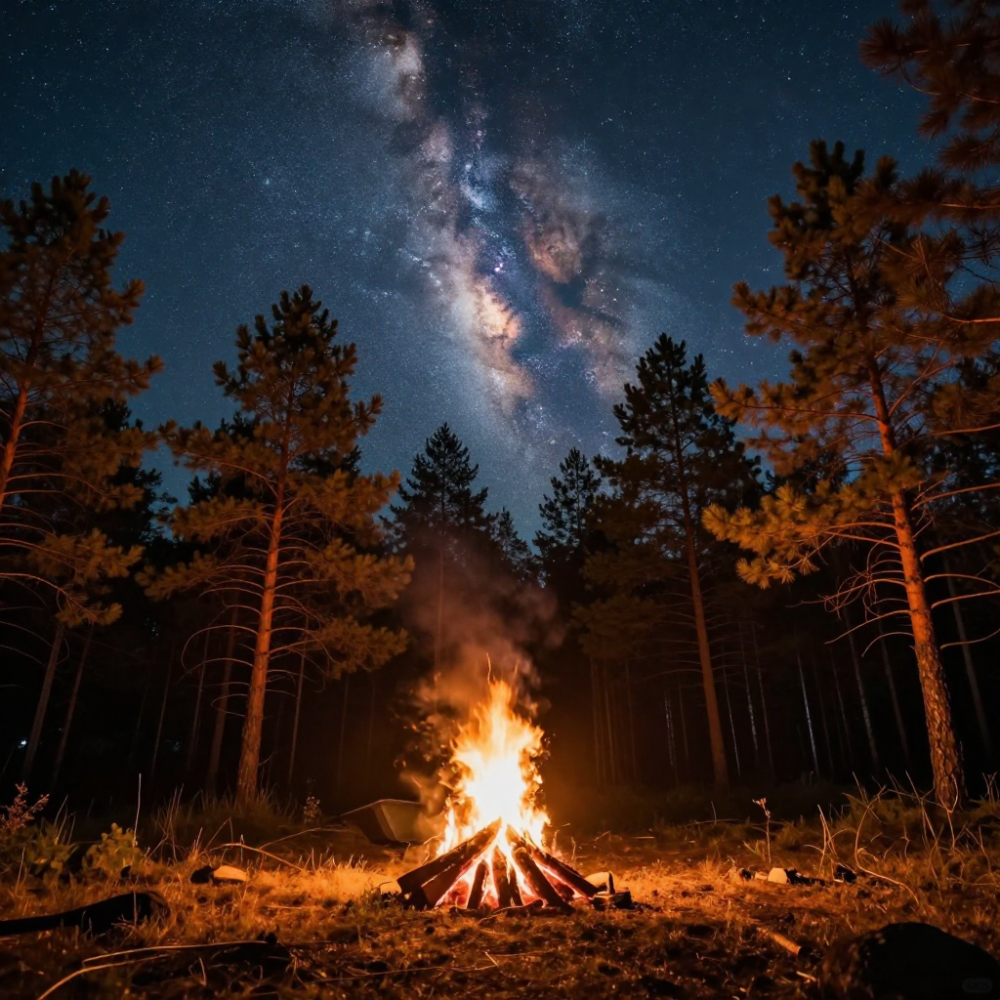

# Image Generation on Amazon ECS with AWS Inferentia2

Production image generation platform running Z-Image-Turbo (a 6B-parameter diffusion transformer) on Amazon ECS. Built as the companion project for the blog post "High-quality cost-effective AI image generation on Amazon ECS." The system supports two inference backends — Inferentia2 (compiled per-resolution) and GPU (arbitrary resolution) — behind an internal ALB, with real-time WebSocket streaming that sends intermediate frames during denoising.

## Architecture



### Request Flow

1. **User** accesses React frontend via CloudFront CDN (also proxies `/api/*` requests)
2. **API Gateway** validates Cognito JWT (HTTP API + WebSocket API)
3. **Lambda** handles request — API (FastAPI/Mangum), WebSocket (streaming), Enhance (Bedrock). Saves to S3 + DynamoDB
4. **Internal ALB** routes to ECS via `X-Target-Resolution` header (VPC-only, no public access)
5. **ECS Inference** — 4 services: 512/768/1024 on inf2.8xlarge + GPU on g5.2xlarge. Least-outstanding-requests routing
6. **EFS** — containers read compiled models + PJRT cache (~2 min from container start to serving, no per-instance compilation). Batch writes compiled NEFFs + weights
7. **Inference Pipeline** (6 stages) — Source → QualityGate → Build (6 Docker images) → Deploy (CDK) → CompileModels (SFN + Batch) → DeployEndpoints (ECS rolling update)
8. **Web Pipeline** (3 stages) — Source → QualityGate → Deploy (CDK web stack + React build + S3 sync + CloudFront invalidation)

### Key Design Decisions

- ECS on EC2 (not Fargate/SageMaker) for full Neuron Core allocation and driver control
- Dual backend: Inferentia2 for cost, GPU for arbitrary resolution flexibility
- Text encoder on Neuron Core 1 as subprocess (frees Core 0 HBM for transformer)
- WebSocket streams intermediate denoising frames in real time
- Model compilation offline via Step Functions + Batch (cached on EFS)
- Internal ALB with least-outstanding-requests (1 inference at a time per instance)

## Quick Start

### Prerequisites

- AWS account with the following service quotas (request via [Service Quotas console](https://console.aws.amazon.com/servicequotas/)):
  - `Running On-Demand Inf instances` >= 32 vCPUs (1x inf2.8xlarge per resolution)
  - `Running On-Demand G and VT instances` >= 8 vCPUs (1x g5.2xlarge for GPU backend)
- Python 3.13+, [`uv`](https://docs.astral.sh/uv/) >= 0.4, Docker, Node.js, AWS CLI
- CDK bootstrapped region: `npx cdk bootstrap aws://ACCOUNT_ID/REGION`

### Deploy

```bash
# 1. Clone and install
git clone https://github.com/aws-samples/sample-image-generation-on-ecs.git && cd sample-image-generation-on-ecs
uv venv --python 3.13 && source .venv/bin/activate
uv sync --group dev

# 2. Configure environment (3 values drive everything)
cp .env.example .env
# Edit .env:
#   CDK_DEFAULT_ACCOUNT=123456789012
#   CDK_DEFAULT_REGION=us-east-1
#   ZIMAGE_ENV=dev

# 3. Bootstrap (deploys platform + cicd stacks)
make bootstrap

# 4. Deploy inference first (web depends on the inference ALB)
make deploy-inference
# Wait for pipeline to complete (~25-45 min on first deploy)

# 5. Deploy web (requires inference stack to be deployed)
make deploy-web

# 6. Create an admin user
make create-admin EMAIL=you@example.com

# 7. Get the web app URL (CloudFront), then open it and sign in
make url
```

First deploy of the inference pipeline takes ~2 hours (weights download + model compilation run on Batch). On subsequent deploys, use `make deploy` to trigger both pipelines simultaneously. If you change which backends are enabled, run `make bootstrap` before `make deploy-inference` to update ECR repos.

## Infrastructure

Six CDK stacks, deployed in dependency order:

| Stack | Deploys | Deployed By |
|-------|---------|-------------|
| `{env}-zimg-platform` | VPC, KMS keys, EFS, VPC endpoints | `make bootstrap` |
| `{env}-zimg-cicd` | ECR repos, CodePipeline, CodeBuild projects | `make bootstrap` |
| `{env}-zimg-inference-infra` | S3 model buckets, DynamoDB cache table | CI/CD pipeline |
| `{env}-zimg-compile-sfn` | Step Functions state machine, Batch compute | CI/CD pipeline |
| `{env}-zimg-inference-ecs` | Up to 4 ECS services (512/768/1024 + GPU when enabled), internal ALB | CI/CD pipeline |
| `{env}-zimg-web` | CloudFront, Cognito, Lambda (API + WebSocket) | CI/CD pipeline |

## CI/CD Pipelines

### Inference Pipeline (6 stages)

| Stage | Action |
|-------|--------|
| Source | Pull context zip from S3 |
| QualityGate | Lint, test, security scan (ASH), CDK synth |
| Build | 6 parallel Docker image builds to ECR |
| Deploy | `cdk deploy` inference-infra + compile-sfn |
| CompileModels | Execute Step Functions state machine |
| DeployEndpoints | `cdk deploy` inference-ecs (rolling ECS update) |

### Web Pipeline (3 stages)

| Stage | Action |
|-------|--------|
| Source | Pull context zip from S3 |
| QualityGate | Lint, test, security scan, CDK synth |
| Deploy | `cdk deploy` web stack (Lambda + CloudFront) |

## Directory Structure

```
├── infra/                   CDK infrastructure (Python)
│   ├── app.py               Entry point — instantiates all stacks
│   ├── config/              Pydantic settings + defaults.yaml + environments/
│   ├── lambdas/             Standalone Lambda handlers (enhance prompt, cache purge)
│   ├── stacks/              One file per CloudFormation stack
│   │   ├── constructs/      Reusable CDK constructs
│   │   │   ├── compute/     ECS, Batch, auto-scaling
│   │   │   ├── network/     VPC, subnets, security groups
│   │   │   ├── cicd/        Pipelines, CodeBuild, deploy scripts
│   │   │   └── web/         Lambda, API Gateway, CloudFront, Cognito
│   │   └── compile_sfn/     Step Functions state machine
│   └── utils/               Enums, contracts, constants, naming
├── runtime/                 Code that runs INSIDE containers
│   ├── lib/                 Shared utilities (S3 sync, cache versioning, contracts)
│   ├── neuron/              Neuron-specific (patches, model loading, IPC)
│   ├── serving/             HTTP server + pipeline classes
│   │   └── production/      Per-resolution pipeline implementations
│   └── compile/             Compilation scripts (Batch jobs)
├── web/
│   ├── backend/             FastAPI app + Lambda handlers
│   │   ├── server.py        REST API (/api/generate, /api/config, /api/health)
│   │   ├── websocket_handler.py  WebSocket streaming (production Lambda)
│   │   ├── gallery.py       DynamoDB + S3 gallery manager
│   │   └── admin.py         Admin endpoints (scale, metrics, pipeline)
│   └── frontend/            React + TypeScript (Vite)
├── tests/
│   ├── cdk/                 CDK synth assertion tests
│   ├── integration/         Integration tests (mocked AWS)
│   └── unit/                Unit tests (mirrors source layout)
├── docs/                    Architecture diagram + sample images
└── .env                     Account, region, environment name (3 values)
```

## Model Compilation

The Step Functions state machine orchestrates compilation on Neuron hardware:

1. Download base model weights from HuggingFace to S3
2. Trace the DiT transformer for each resolution (512, 768, 1024) on Batch (inf2.8xlarge)
3. Trace VAE decoder and text encoder
4. Run warmup inference to populate Neuron persistent cache
5. Upload compiled NEFFs + cache to EFS

Subsequent deploys skip compilation if the cache version matches (DynamoDB tracks versions).

## Configuration

### Environment (.env)

The `.env` file is the single source of truth. Only 3 values:

```
CDK_DEFAULT_ACCOUNT=123456789012
CDK_DEFAULT_REGION=us-east-1
ZIMAGE_ENV=dev
```

### Infrastructure Tuning (defaults.yaml)

All tunable parameters live in `infra/config/defaults.yaml`. Per-environment overrides go in `infra/config/environments/{env}.yaml` (optional — falls back to defaults if no override file exists).

### Backend Configuration

Both backends are enabled by default in `dev.yaml`:

```yaml
# infra/config/environments/dev.yaml
inferentia_endpoint:
  enabled: true
  min_capacity: 1
  max_capacity: 2

gpu_endpoint:
  enabled: true
  min_capacity: 1
  max_capacity: 2
```

The **GPU endpoint** (g5.2xlarge) accepts arbitrary width x height as long as both dimensions are divisible by 8, each side is at least 256px, and the total pixel count does not exceed 1,048,576 (1024x1024 equivalent).

The **Inferentia2 endpoint** (inf2.8xlarge) serves fixed square resolutions: 512x512, 768x768, 1024x1024. Each resolution runs as a separate ECS service with its own compiled model.

Disable either backend by setting `enabled: false` and redeploying. When changing which backends are enabled, run `make bootstrap` first (to create/remove ECR repos), then `make deploy-inference`.

## Make Commands

### Quality

| Command | Description |
|---------|-------------|
| `make check` | Full quality gate (lint + test + synth) |
| `make lint` | Ruff check + format + ty + file length |
| `make format` | Auto-fix formatting and imports |
| `make test` | Run all tests with coverage |
| `make synth` | CDK synth all stacks + cdk-nag |
| `make security` | Security scan (full repo) |

### Deploy

| Command | Description |
|---------|-------------|
| `make bootstrap` | One-time: deploy platform + cicd stacks |
| `make deploy` | Trigger both pipelines (use only after first deploy) |
| `make deploy-inference` | Trigger inference pipeline only |
| `make deploy-web` | Trigger web pipeline only |

### Compile

| Command | Description |
|---------|-------------|
| `make compile-models` | Start compile state machine execution |
| `make wait-compile` | Wait for current SFN execution to finish |
| `make warmup-tail` | Tail last warmup job logs |

### Users

| Command | Description |
|---------|-------------|
| `make create-admin EMAIL=...` | Create admin user in Cognito |
| `make create-user EMAIL=...` | Create non-admin user |

### Teardown

| Command | Description |
|---------|-------------|
| `make destroy` | Destroy all stacks (reversed order) |
| `make force-destroy` | Force delete via CloudFormation |
| `make clean-retained` | Clean orphaned resources |
| `make clean` | Remove local build artifacts |

## Teardown

```bash
make destroy
```

Destroys all stacks in reverse dependency order and cleans retained resources.

If `make destroy` gets stuck or leaves stacks behind (for example a stack in `UPDATE_ROLLBACK_COMPLETE` or a cross-stack export deadlock), force a full cleanup:

```bash
make force-destroy
```

Deletes every stack directly through CloudFormation, then removes retained ECR repos, S3 buckets and other resources tagged `App=z-image-inferentia-<env>`.

Both commands finish by running `clean-retained`. To sweep orphaned resources on their own (for example after a partial destroy), run:

```bash
make clean-retained
```

Removes resources tagged `App=z-image-inferentia-<env>` that outlive their stacks: ECR repos, S3 buckets (emptied first), log groups, NAT gateways, VPC endpoints, VPC flow logs and Batch job definitions. KMS keys are scheduled for deletion after 7 days.

## Samples

Generated on Inferentia2 (inf2.8xlarge), 8 Euler steps, CFG-free. Same seed across resolutions to show quality scaling. All prompts shown are the **exact text sent to the model** — run them with the listed seed to reproduce these images identically.

---

> **Film Noir** (seed 6)
>
> Woman with short jet-black tousled hair leaning against a dusty classic black sedan in a dimly lit industrial garage. Her sharp detailed face features high cheekbones, almond-shaped eyes, and light freckles across her nose. She has an amused smirk showing slight dimples. She is wearing a white button-down shirt over a black tank top and faded, distressed jeans. Her hands are in her pockets. A direct camera flash creates harsh frontal lighting with hard shadows behind her. The scene has film grain and light leaks with flickering fluorescent lights. The color palette is muted and desaturated, evoking a dramatic noir lighting style with a shallow depth of field.

<table>
<tr>
<td align="center"><strong>512 x 512</strong></td>
<td align="center"><strong>768 x 768</strong></td>
<td align="center"><strong>1024 x 1024</strong></td>
</tr>
<tr>
<td></td>
<td></td>
<td></td>
</tr>
</table>

---

> **Ballet** (seed 737111)
>
> Ballerina performing an arabesque inside a decaying industrial warehouse. The dancer stands en pointe on her right foot, her extended left leg forming a 90-degree angle relative to the standing leg and torso. The body is angled slightly to the right, facing forward with head turned slightly to the left. Dressed in a flowing white tulle tutu that reaches the floor, the costume has a sweetheart neckline and a fitted bodice. The lighting consists of a dramatic shaft of natural daylight entering through a shattered window on the left side of the frame. This creates high contrast black-and-white photography with deep, intense shadows covering the majority of the warehouse floor and walls. The floor is concrete with visible cracks and rust-colored stains. The depth of field is very shallow, rendered with an 85mm lens at f/1.4 aperture, keeping the dancer's illuminated face and the edge of the outstretched arm in focus, while the body and surroundings fall into soft blur. The background reveals partially collapsed metal structures, rusted pipes, and faded graffiti. The atmosphere is cold and desolate, with dust particles visible in the shaft of light. There are no additional elements present except for the dancer and architectural remnants.

<table>
<tr>
<td align="center"><strong>512 x 512</strong></td>
<td align="center"><strong>768 x 768</strong></td>
<td align="center"><strong>1024 x 1024</strong></td>
</tr>
<tr>
<td></td>
<td></td>
<td></td>
</tr>
</table>

---

> **Album Art** (seed 723376)
>
> Rock band album cover art featuring a red electric guitar engulfed in blue and purple flames, floating in a dark void, surrounded by shattered glass fragments with sharp edges and iridescent surface reflections under dim ambient lighting, bold creative stylized grunge text "IRON ECHO" centered at the top in cracked metallic chrome font with a yellow lightning bolt extending to the left of the text, smaller neon purple text "SHATTERED LIGHT" placed horizontally at the bottom of the composition, fonts with jagged edges and glowing outlines, black background with subtle texture resembling brushed steel, 50mm macro lens perspective emphasizing detailed textures of metal, glass, and flame surfaces, high definition rendering with emphasis on realistic lighting effects and sharp depth of field.

<table>
<tr>
<td align="center"><strong>512 x 512</strong></td>
<td align="center"><strong>768 x 768</strong></td>
<td align="center"><strong>1024 x 1024</strong></td>
</tr>
<tr>
<td></td>
<td></td>
<td></td>
</tr>
</table>

---

**LLM-Enhanced Prompts** — The following use simple one-line prompts rewritten by the built-in Qwen3-32B enhancer:

---

> **Coral Reef** (seed 414395)
>
> A vibrant underwater coral reef scene in a clear, shallow tropical sea. The reef is teeming with life, showcasing a variety of coral structures including massive brain coral, branching staghorn coral, and colorful soft fans. The sea floor is covered with sandy patches and scattered rocks. The water is crystal clear with a deep blue tint above and a brighter turquoise near the surface. Schools of tropical fish swim in various directions. Among them: yellow tang with a black tail, blue and gold clownfish swimming near a sea anemone, a longtail fusilier with bright blue body and a dark vertical bar, and a royal gramma with black and yellow stripes. The fish exhibit realistic movements and behaviors, some feeding on plankton, others darting quickly to avoid a passing moray eel peeking out from a coral crevice. Bubbles of air rise from a small underwater spring nearby, adding dynamic movement. Sunlight filters through the surface in shafts of bright white and gold, casting dappled patterns on the reef and fish bodies. The scene is viewed from a moderate underwater depth, with the reef occupying the lower two-thirds of the frame, and a natural sense of depth indicated by decreasing clarity and light in the background.

<table>
<tr>
<td align="center"><strong>512 x 512</strong></td>
<td align="center"><strong>768 x 768</strong></td>
<td align="center"><strong>1024 x 1024</strong></td>
</tr>
<tr>
<td></td>
<td></td>
<td></td>
</tr>
</table>

---

> **Northern Lights** (seed 481246)
>
> A vast, frozen lake at night, with a smooth, ice-covered surface reflecting the vibrant aurora above. The sky is filled with swirling bands of green and light purple northern lights, glowing faintly in the dim ambient light. The landscape includes sparse pine trees surrounding the lake's edge, their dark, slender forms contrasting with the luminous sky. The atmosphere is cold and clear, with no clouds obstructing the view of the sky. The scene is captured from a low-angle perspective to emphasize the vastness of the sky and the stillness of the frozen lake.

<table>
<tr>
<td align="center"><strong>512 x 512</strong></td>
<td align="center"><strong>768 x 768</strong></td>
<td align="center"><strong>1024 x 1024</strong></td>
</tr>
<tr>
<td></td>
<td></td>
<td></td>
</tr>
</table>

---

> **Campfire** (seed 996776)
>
> A campfire is burning in a remote wilderness area under the night sky. The fire is composed of flame and glowing embers, situated on a flat forest floor surrounded by pine trees. Above the fire, the sky is clear and dark, with the milky way stretching from the horizon into the upper sky. The milky way appears as a bright, swirling band of stars with subtle blue and orange tones. The surrounding trees are tall, with conical shapes, their trunks are dark and textured. Smoke from the fire rises vertically and dissipates into the sky. The atmosphere is cool and calm, with no wind. The scene is illuminated by the soft glow of the fire and the faint light of the stars. The color palette is a combination of warm orange and yellow from the fire and cool blue from the night sky.

<table>
<tr>
<td align="center"><strong>512 x 512</strong></td>
<td align="center"><strong>768 x 768</strong></td>
<td align="center"><strong>1024 x 1024</strong></td>
</tr>
<tr>
<td></td>
<td></td>
<td></td>
</tr>
</table>

## Security

See [CONTRIBUTING](CONTRIBUTING.md#security-issue-notifications) for more information.

## License

This library is licensed under the MIT-0 License. See the [LICENSE](LICENSE) file.
